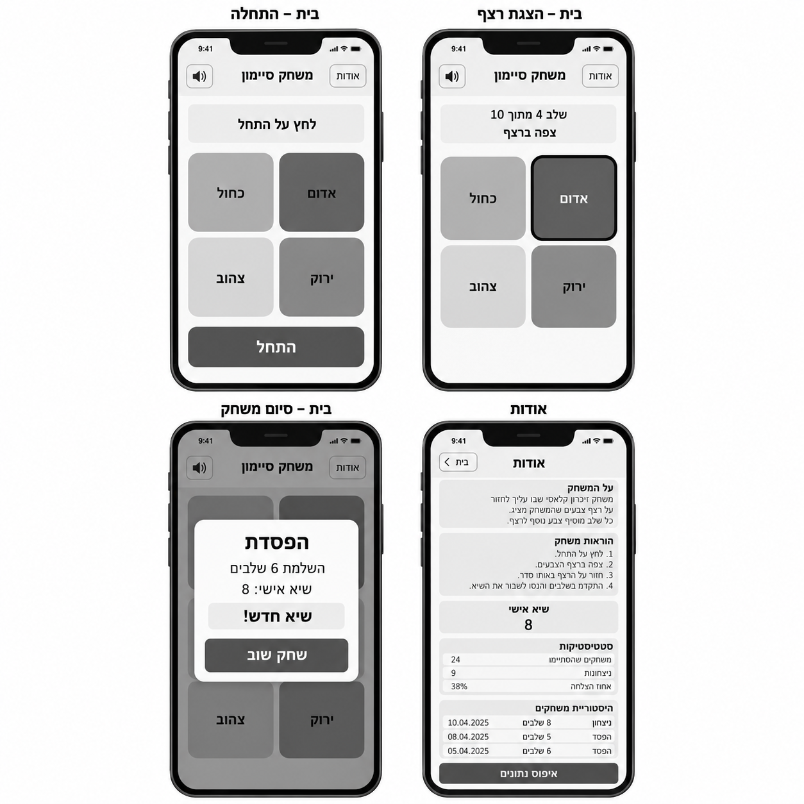
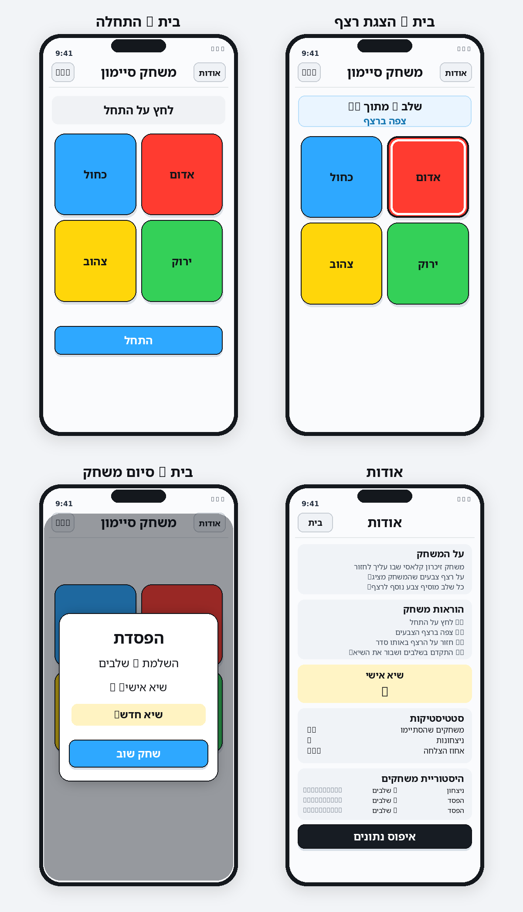
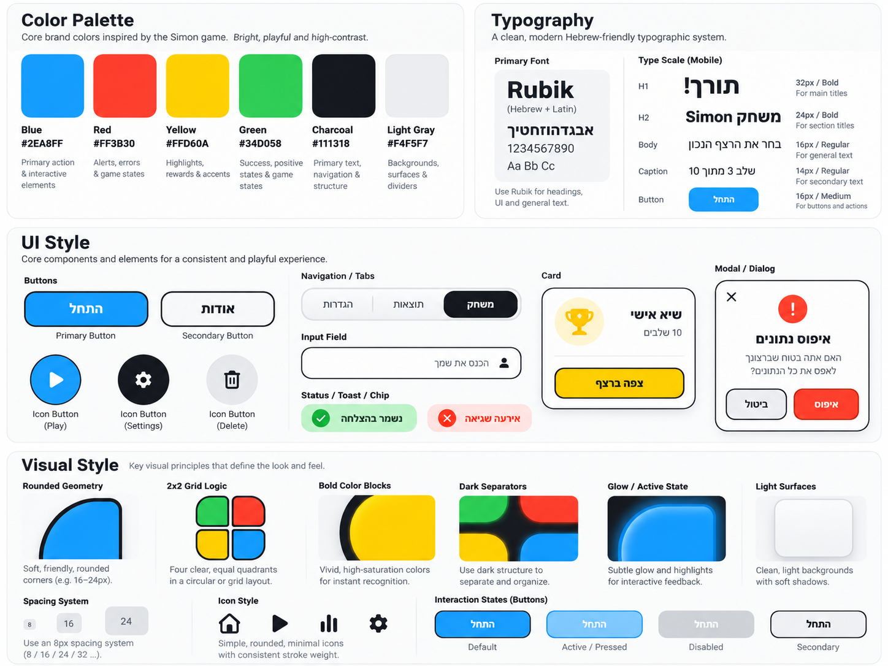

# DESIGN – עיצוב אפליקציית Simon

מסמך זה מתאר את ממשק המשתמש של משחק הזיכרון Simon למובייל. ההגדרות הפונקציונליות וההתנהגות העסקית מפורטות ב־`PRD.md`; כאן מתוארים מבנה המסכים והמימוש החזותי. **מסך הבית ומסך ״אודות״ הם שני המסכים היחידים**. תצוגת הרצף וחלונית סיום המשחק הן מצבים בתוך מסך הבית, ולא מסכים עצמאיים.

## 1. Screens – מסכי האפליקציה

### מקורות חזותיים למסכים

**Wireframes – המבנה והפריסה:**

**Mockups – המראה החזותי המיועד:**

### 1.1 בית – מצב התחלתי

- **מטרה:** לאפשר התחלת משחק ונגישות לשמע ולמסך ״אודות״.
- **מבנה ותוכן:** סרגל עליון עם שם המשחק ״משחק סיימון״ במרכז, כפתור השתקה/הפעלה בצד אחד וכפתור ״אודות״ בצד האחר. מתחתיו אזור סטטוס התחלתי (״לחץ על התחל״), לוח מרכזי של ארבעה כפתורי צבע גדולים ברשת 2×2, וכפתור ראשי ״התחל״ מתחת ללוח.
- **פריסת הלוח:** שורה עליונה — כחול משמאל ואדום מימין; שורה תחתונה — צהוב משמאל וירוק מימין. לכל כפתור תווית צבע בעברית. הקפדה על שטח לחיצה גדול ומרווח אחיד בין ארבעת הכפתורים.
- **פעולות וניווט:** ״התחל״ מעביר את מסך הבית למצב הצגת הרצף; כפתור השמע משנה השתקה; ״אודות״ פותח את מסך ״אודות״.

### 1.2 בית – מצב הצגת רצף וקלט שחקן

- **מטרה:** להציג את הרצף ולסמן בצורה בולטת מתי המשתמש צופה ומתי עליו לשחזר.
- **מבנה ותוכן:** סרגל העליון ולוח ארבעת הצבעים נותרים באותם מקומות. מעל הלוח מוצגים ״שלב X מתוך 10״ והודעת המצב ״צפה ברצף״; עם סיום ההצגה משתנה הודעת המצב ל־״תורך!״.
- **משוב חזותי:** הכפתור הפעיל ברצף מובלט באמצעות מסגרת או הארה בולטת בצבעו, בלי להזיז את הכפתורים או לשנות את צורתם. בזמן הצגת הרצף הכפתורים אינם זמינים ללחיצה; בזמן קלט השחקן ניתנת הבלטה זמנית לכפתור שנלחץ. אין פס התקדמות.
- **פעולות וניווט:** בזמן תור השחקן, לחיצה על צבע משחזרת את הקלט. לאחר רצף נכון מתחלף מספר השלב אוטומטית; טעות או השלמת השלב העשירי מובילות לחלונית הסיום בתוך מסך הבית. מעבר ל״אודות״ מבטל את המשחק הפעיל לפי ה־PRD.

### 1.3 בית – מצב סיום משחק

- **מטרה:** להציג את תוצאת המשחק ולאפשר משחק חוזר.
- **מבנה ותוכן:** מעל מסך הבית מופיע רקע כהה ושקוף למחצה (Overlay) ובמרכזו חלונית (Modal) בהירה עם פינות מעוגלות. החלונית מציגה כותרת ״הפסדת״ או הודעת ניצחון, את מספר השלבים שהושלמו, את השיא האישי, ובמקרה המתאים הדגשה של ״שיא חדש!״. בתחתית נמצא כפתור ראשי ״שחק שוב״.
- **פעולות וניווט:** ״שחק שוב״ סוגר את החלונית ומתחיל משחק חדש במסך הבית. אין צורך במסך תוצאות נפרד.

### 1.4 אודות

- **מטרה:** להציג הסבר, הוראות, תוצאות עבר ונתונים מסכמים, ולאפשר איפוס נתונים.
- **מבנה ותוכן:** סרגל עליון עם כותרת ״אודות״ וכפתור ״בית״ לחזרה; בהמשך כרטיסי תוכן אנכיים: ״על המשחק״, ״הוראות משחק״, ״שיא אישי״ (עם ערך בולט), ״סטטיסטיקות״ (משחקים שהסתיימו, ניצחונות ואחוז הצלחה), ו״היסטוריית משחקים״ (רשימת תאריך, שלבים שהושלמו ותוצאת משחק). בתחתית אזור התוכן מופיע כפתור ״איפוס נתונים״.
- **גלילה:** התוכן מוצג בעמודה אחת; כשאין מקום לכל הרשימה, העמוד גולל אנכית בתוך גובה מסך הטלפון. אין להאריך את גובה התצוגה הקבוע או לדחוס את הטקסט.
- **פעולות וניווט:** ״בית״ מחזיר למצב ההתחלתי של מסך הבית. ״איפוס נתונים״ מציג Dialog לאישור או לביטול, בלי לפתוח מסך נוסף. ריקון נתונים ועדכון הכרטיסים נעשים לפי ה־PRD.

### 1.5 ניווט כללי

הניווט הוא מעבר ישיר בין **בית ↔ אודות** באמצעות הכפתורים בסרגל העליון. אין Tab Bar, תפריט צד, מסך ״הגדרות״ או מסך ״היסטוריה״ עצמאי. הודעת סיום ו־Dialog אישור מחיקה הם שכבות על המסך הקיים; יתר מצבי המשחק מוצגים בתוך מסך הבית.

## 2. Style Guide – השפה העיצובית

### 2.1 Color Palette

קודי הצבעים הבאים נקבעו בתמונת ה־Style Guide:

| Token / תפקיד | צבע | HEX | שימוש |
|---|---|---|---|
| `blue` | Blue | `#2EA8FF` | כפתור המשחק הכחול ופעולה ראשית כגון ״התחל״ או ״שחק שוב״ |
| `red` | Red | `#FF3B30` | כפתור המשחק האדום; חיווי אזהרה ואישור פעולה הרסנית |
| `yellow` | Yellow | `#FFD60A` | כפתור המשחק הצהוב; הדגשת ״שיא חדש!״ וכרטיס שיא |
| `green` | Green | `#34D058` | כפתור המשחק הירוק; מצבי הצלחה |
| `charcoal` | Charcoal | `#111318` | טקסט ראשי, קווי מתאר ורכיבי ניווט כהים |
| `light-gray` | Light Gray | `#F4F5F7` | רקע עמוד, משטחי תוכן והפרדה בין אזורים |

- **שימוש בפועל:** ה־Mockups משתמשים ברקע בהיר מאוד, בלוח עם ארבעה משטחי צבע רוויים, בקווי מתאר כהים ובכפתורי פעולה כחולים. צבעי הכפתורים אינם מתחלפים בין מצבי המשחק.
- **ניגודיות:** על רקעים בהירים טקסט כהה; על כפתורי פעולה כחולים טקסט לבן כפי שמודגם ב־Mockups. המשוב על צבע פעיל משלב הארה/קו מתאר, ולא מסתמך על צבע בלבד.
- **הבחנה בין מקורות:** ה־Style Guide מגדיר את ערכי ה־HEX; ייתכנו הבדלי גוון קלים ברינדור של ה־Mockups, אך ערכי ה־Style Guide הם מקור האמת למימוש.

### 2.2 Typography

| רמה | הגדרה | שימוש |
|---|---|---|
| Font Family | `Rubik`, עם גופן מערכת תומך עברית כ־Fallback | כל רכיבי ממשק המשתמש בעברית |
| H1 | `32px / Bold` | כותרת ראשית או תוצאת סיום גדולה |
| H2 | `24px / Bold` | שם המסך וכותרות מדורים מרכזיים |
| Body | `16px / Regular` | הוראות, פרטי היסטוריה ותוכן כרטיסים |
| Caption | `14px / Regular` | טקסט משני, תיאור ומידע תמציתי |
| Button | `16px / Medium` | כפתורים ותוויות פעולה |

הכותרות והערכים החשובים משתמשים במשקל מודגש. במשחק עצמו שורת השלב והודעת המצב ממורכזות; במסך ״אודות״ כותרות מדורים ותוכן מיושרים לימין, בהתאם ל־RTL. אין להשתמש בטקסט לטיני דקורטיבי מן ההשראה כתחליף לתוויות הממשק בעברית.

### 2.3 UI Style

- **כפתורי המשחק:** ארבעה אריחים זהים מבחינת ממדים, מעוגלים, עם צבע מלא, מסגרת כהה בולטת וצל קצר ועדין. מצב Active מבליט את האריח באמצעות הארה ומסגרת פנימית בהירה, כמוצג באריח האדום בתצוגת הרצף.
- **Primary Button:** משטח כחול מלא, פינות מעוגלות, תווית לבנה מודגשת וצל קל. משמש ל״התחל״ ול״שחק שוב״.
- **Secondary Button:** משטח לבן/אפור בהיר ומסגרת כהה או עדינה; מתאים לכפתורי ניווט כגון ״אודות״ ו״בית״.
- **פעולות הרסניות:** ״איפוס נתונים״ מופיע ככפתור כהה בולט במסך ״אודות״; Dialog האישור משתמש בפעולת אישור מודגשת ובפעולת ביטול נפרדת. לא מוסיפים פעולה ללא אישור.
- **Cards:** משטחים בהירים או אפורים בהירים בעלי פינות מעוגלות, עם הפרדה במרווחים; כרטיס השיא מובחן בגוון צהוב עדין, בהתאם ל־Mockups.
- **Modal / Dialog:** שכבה מרכזית מעל Overlay כהה; משטח לבן, גבול כהה דק ופינות מעוגלות, עם כותרת והיררכיית מידע ברורה.
- **סרגל ניווט:** כותרת מרכזית וכפתורי פעולה קטנים בקצוות; רכיבי הניווט נותרים עקביים בין מצבי מסך הבית.
- **Icons:** אייקונים פשוטים, מעוגלים, בעובי קו אחיד. בפועל נדרש אייקון שמע/השתקה בסרגל המשחק; ה־Style Guide מציג דוגמאות לאייקונים נוספים אך **אינו מאשר הוספת יכולות או מסכים**.
- **Input Fields / Tabs:** ה־Style Guide מציג דוגמאות עיצוביות, אך אין שדות קלט או Tab Navigation במוצר הזה לפי ה־PRD, ולכן אין לממש אותם.

### 2.4 Visual Style

- **אופי חזותי:** משחקי, ברור ומודרני; ארבעת צבעי Simon הם מוקד המסך על רקע ניטרלי. שימוש במסגרת כהה יוצר הפרדה גרפית שמאזכרת את משחק Simon הפיזי.
- **Geometry:** ארבעה אריחים ברשת 2×2 עם ממדים דומים, פינות רכות של כ־`16–24px` לפי ה־Style Guide, ומרווחים עקביים. הכפתורים אינם הופכים ללוח עגול: ה־Wireframes קובעים לוח אריחים מודרני.
- **Borders & Shadows:** קווי מתאר כהים סביב כפתורי המשחק, צללים עדינים סביב משטחים וכפתורים; הארה ממוקדת רק כמשוב לפעולת צבע, לא כעיטור קבוע.
- **Spacing:** מערכת מרווחים המבוססת על כפולות `8px` (בייחוד `8 / 16 / 24 / 32px`). שמירה על רווח בין סרגל הכותרת, סטטוס המשחק, הלוח וכפתור הפעולה.
- **Layout:** Mobile-First, עמודה אנכית אחת בכל מסך; לוח המשחק במרכז האזור הראשי; במסך ״אודות״ כרטיסים בערימה אנכית, רשימה גלילה וכפתור איפוס מתחתיה.
- **Imagery:** אין תמונות תוכן או איורים עצמאיים במסכי המוצר. צורות הכפתורים, קווי המסגרת, הצבעים והאייקונים הפשוטים הם השפה הגרפית.
- **מצבים חזותיים:** מצב ברירת מחדל, לחוץ/מואר וחסום מוצגים באמצעות הבדלי הארה, מסגרת וניגודיות, ללא שינוי במיקום הרכיבים.

### 2.5 שפה וכיווניות

- שפת כל רכיבי הממשק היא **עברית**; מסמכי התכנון רשאים להשתמש במונחים מקצועיים באנגלית.
- מסמכי ה־UI ימומשו בכיווניות `RTL` וביישור לימין לתוכן מילולי ולרשימות; כותרות מסך, תוצאת המשחק והודעות הסטטוס נשארות ממורכזות בהתאם ל־Wireframes.
- לוח 2×2 שומר על מיקום הצבעים כפי שתועד, ללא היפוך אוטומטי של מיקומי האריחים בעת הפעלת RTL.
- מספרים, תאריכים ואחוזים יוצגו בצורה קריאה לצד התוויות בעברית; ניתן לבודד מקטעים מספריים ב־`LTR` לפי הצורך, בלי לשנות את כיווניות המסך.

### 2.6 קדימות המקורות ודיוק המימוש

1. `PRD.md` הוא מקור האמת לתכולת המוצר ולהתנהגות.
2. `wireframes.png` קובע את מספר הייצוגים, הסידור, המבנה ורכיבי ה־UI.
3. `style-guide.png` קובע צבעים, גופן, טיפוגרפיה ועקרונות עיצוב.
4. `mockups.png` ממחיש את המראה הרצוי תוך כפיפות לשלושת המקורות לעיל.

**הבהרת עקביות:** בתמונות מופיעים מדי פעם סימנים מטושטשים או מספרים לדוגמה שאינם קריאים. יש להשתמש בנוסחים התקינים בעברית ובנתונים הדינמיים המוגדרים ב־PRD, ולא להעתיק שיבושי טקסט מתוך ההמחשה. דוגמאות כלליות ב־Style Guide (כמו שדות קלט, Tabs או אייקון Settings) אינן מוסיפות פיצ'רים למוצר.
